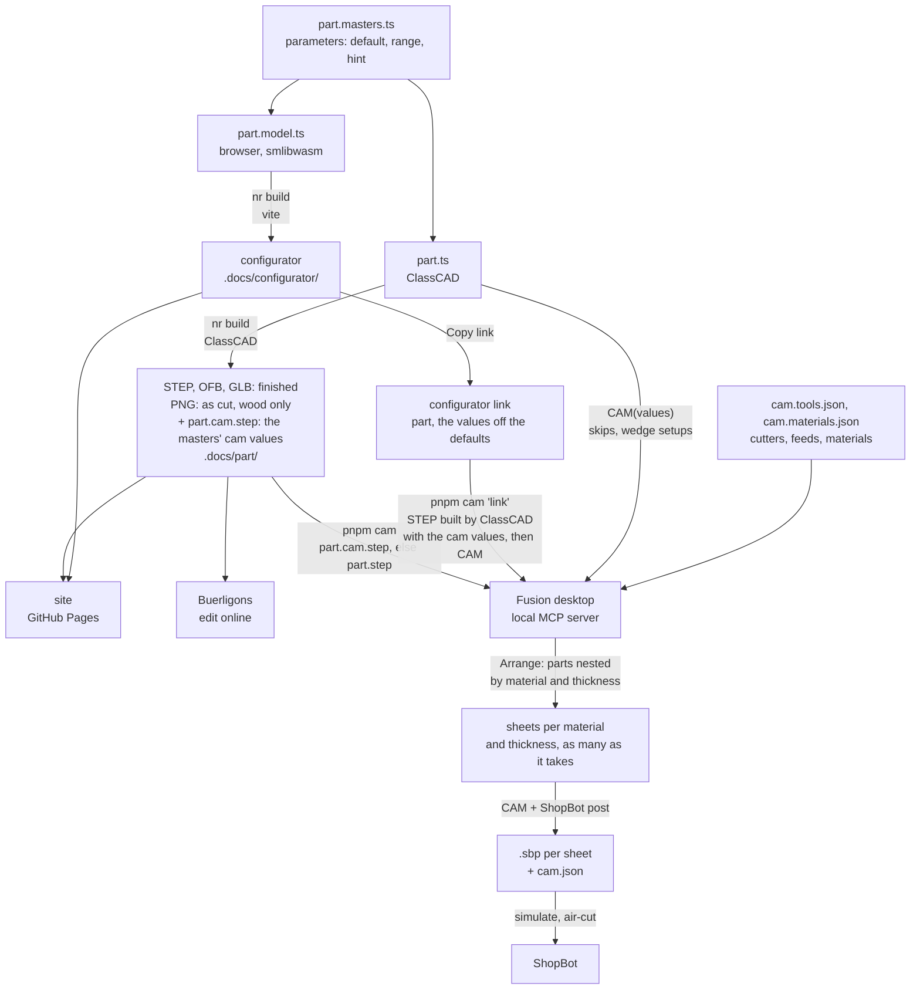

# integral

We integrate others' work into things.

<Intro>

Real objects, designed and made with whatever tools fit: CAD, code, machines.

</Intro>

## Parts

| | Part |
|---|---|
| <a href="https://abernier.github.io/integral/things/compass-armchair"></a> | **[Compass armchair](https://abernier.github.io/integral/things/compass-armchair)**: A cane armchair on compass legs, after the 1955 Chandigarh office chair, parametric, in teak. |
| <a href="https://abernier.github.io/integral/things/zigzag-chair"></a> | **[Zigzag chair](https://abernier.github.io/integral/things/zigzag-chair)**: Rietveld's 1934 Zig-Zag chair, parametric, in cherry. |

## Build

<Steps>

<Step>Install</Step>

```sh
pnpm install
```

<Step>Work on the site, live</Step>

```sh
nr dev        # localhost:3000; saving a part's .ts rebuilds it; saving a .model.ts rebuilds the configurator (reload the page)
```

<Step>Check and build</Step>

```sh
nr typecheck  # tsc --noEmit
nr build      # parts + configurator + site into dist/
```

</Steps>

- Part: `<folder>/<folder>.ts` + `README.md`; generated files stay out of git
- Build cache: a part whose sources, masters, shared build scripts and lockfile are unchanged is not built again (its key sits beside its files, `.docs/<part>/<part>.key`); `nr build:parts --force` rebuilds every part
- Engine patch (`patches/@classcad__mcp@0.6.1.patch`): the local WASM engine runs without structure-tree patches, which it otherwise computes over the whole tree after every command, making a build quadratic in its feature count (compass-armchair: 82.9 s to 19.2 s, same geometry); the build reads the tree itself (`nameSolids` pulls it), nothing here uses the patches
- Configurator: `configurator/` (Vite + r3f + leva, the "Configurator" tab; `nr dev:configurator` runs it alone, `nr test` checks each model's schema and builds it, plus the query-string helpers, the docs' theme picks, the masters' defaults and a link's values, and the CAM config following the values); it wears the docs' Material 3 theme and follows it live from their localStorage (light or dark, and the reader's primary color, contrast, scheme and color match), with no toggle of its own; a part is picked up from `<folder>/<folder>.model.ts` (`schema`, `build`), nothing to register; its parameters (default, range, hint; `main` puts a slider at the top, the rest go under Details) live in `<folder>/<folder>.masters.ts`, shared with the ClassCAD part; "Copy link" gives the link `pnpm cam` takes
- Variants: a part's named versions (a cane seat, a leather cushion) are the optional `VARIANTS` export of its masters module, the first the default, each with its own defaults for some masters; a master's `variants` lists the ones it means something in. Both kernels get the variant's id (`build(values, variant)`, `build(api, values, variant)`, `CAM(values, variant)`); the configurator's Variant list sits before Reset (Reset goes back to the variant's defaults, tweaks survive a switch, the link carries `variant`), and its Show folder hides meshes by their `userData.role` (wood, cane, cushion...) and, for a part whose masters have `cam` values, has a Handwork checkbox: off, the part as the ShopBot cuts it (those values on top of the sliders'; not in the link). `nr build` builds every variant: the default as `<part>.<ext>`, any other as `<part>.<variant>.<ext>`; `pnpm cam` takes a link's variant, or `--variant <id>`. A part without `VARIANTS` has one, implicit
- Image: a part's `<part>[.<variant>].png`, its README's and its page's, is the part as cut, wood only: built with its masters' `cam` values when it has some (the CAM STEP's build: no rounds, no groove) and showing the bodies whose role is `wood` (the optional `ROLES` export of `<folder>/<folder>.ts`, by solid name, the browser model's mesh roles; a name not listed is wood); its STEP, OFB and GLB are the finished part, every body in it
- Engine key: local ClassCAD sign-in; in CI, the `CLASSCAD_TOKEN` secret
- CAM: `pnpm cam <folder>`, or `pnpm cam '<link>'` for the values of a configurator link, see [CAM](https://abernier.github.io/integral/integral/cam); it reads `.docs/<folder>/<folder>.cam.step` when a master has a `cam` value (a finish made by hand, such as an edge round, 0 in the files): `nr build:parts` writes it beside the part's STEP, built with the masters' `cam` values (`camValues`, `scripts/masters.ts`), so the files cut square
- Deploy: every push to `main`, GitHub Pages; every pull request, a Vercel preview (`vercel.json`, the engine key in its `CLASSCAD_TOKEN` variable)

## Pipeline

From a part's code to the machine. `nr build` runs in CI; `pnpm cam` only on a machine with Fusion desktop open.


