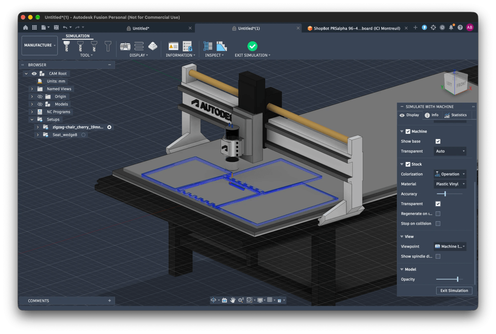

# CAM

Computer-aided manufacturing: the CNC files of a model, made by Fusion from the command line.

<Intro>

`pnpm cam <model>` makes the ShopBot files (`.sbp`) of a model. It drives Fusion's CAM through Fusion's local MCP server, with no clicking. It writes one file per sheet into `.docs/<model>/cam/`, outside git, with a record of the run in `cam.json`.

</Intro>

Fusion does the CAM work: it lays the parts out on the sheet (Arrange), finds the pockets, computes the toolpaths, works out what the main tool leaves behind (rest machining), and takes the feeds and stepdowns from its tool library.

The code only prepares Fusion's job. It groups the parts by material and thickness, turns each part so its grain runs along the sheet, picks the tool, passes the values, and adds the wedge setups that Arrange cannot do. Each step is one small script sent to Fusion, [`cam.fusion-job.py`](https://github.com/abernier/integral/blob/main/scripts/cam.fusion-job.py); its header lists them.

**Simulate every `.sbp` before cutting**, in Fusion or the ShopBot Previewer. Air-cut it first. Check the units, the zero and the tool against the machine.

## Prerequisites

- [ ] Fusion desktop (macOS or Windows), signed in. Fusion for Personal Use is enough: it posts ShopBot OpenSBP, but its rapids run at the cutting feed, and with no tool change each tool gets its own file.
- [ ] Fusion's MCP server on: Preferences > General > API > *Fusion MCP Server (runs locally on this device)*. On another port, set `FUSION_MCP_URL`. `pnpm cam --list-tools` checks the connection.
- [ ] No command dialog open in Fusion during a run.
- [ ] The model's STEP in `.docs/<model>/`, one component per part: `nr build:parts` makes it (a run given a link builds its own STEP first). `pnpm cam` reads `<model>.step`, unless a master of the model has a `cam` value (`Control.cam`: a finish made by hand, such as an edge round, 0 in the files): the build then also writes `<model>.cam.step`, the model built again with the masters' `cam` values in place of theirs (`camValues` in [`masters.ts`](https://github.com/abernier/integral/blob/main/scripts/masters.ts)), and that is the STEP `pnpm cam` reads: the files cut square.
- [ ] The tools of [`cam.tools.json`](https://github.com/abernier/integral/blob/main/scripts/cam.tools.json) match the cutters on your ShopBot, and their presets match your wood.

## Run

```sh
pnpm cam --help                        # every flag, its default
pnpm cam --list-tools                  # what Fusion's MCP server offers
pnpm cam zigzag-chair --dry-run        # the plan, nothing sent
pnpm cam zigzag-chair --force --keep   # then Simulate the setups in Fusion
pnpm cam --force                       # every model, every file made again
```

With `--keep`, the document stays open in Fusion: select a setup, Actions > Simulate, and watch the stock go. With a machine on the setup, Simulate with Machine shows the sheet on the ShopBot, and the tool going into anything it should not.



<details>
<summary>The ShopBot in Fusion</summary>

The machine is a local Fusion setting, not in the repo. Fusion's API cannot put a simulation-ready machine on a setup, so it is picked by hand on each `--keep` run: double-click the setup, Machine > Select > My machines > Local.

It is Autodesk's generic 3-axis router, made into the workshop's ShopBot PRSalpha 96-48:

- travel X 2500, Y 1250, Z 150 mm; spindle 6000 to 18000 rpm;
- the table stretched along X to 2540 x 1300 mm, with a 19 mm spoilboard on it;
- the table's attach point at `[0, 0, 19.3]`, the spoilboard's top centre.

Every setup the script makes is laid on the table by its stock's bottom centre (Part Position > Stock box point), so every sheet lands centred on the spoilboard, whatever the model.

The 0.3 above the spoilboard is the cut's overcut (`deepest` in `cam.json` is the thickness plus 0.3): the planned pass below the sheet cuts air, and a deeper one hits the spoilboard and shows as a collision. Change one, change the other.

Fusion for Personal Use simulates no tool change on the machine: for a sheet with a rest pass, select its operations but Rest, then Simulate with Machine.

The machine is a `.mch` file in Fusion's machine library (`~/Library/Application Support/Autodesk/CAM360/machines/` on macOS), and its 3D model is a Fusion document in the cloud, which the `.mch` names. The machine is Z up, and so must the documents be: Preferences > General > Default modeling orientation, Z up.

</details>

Files that already exist are left alone, so a run is cheap to repeat. To work on one part, `--only <part>` writes to a folder of its own.

A model with values of its own, not the defaults: `pnpm cam '<link>'`, the link the configurator's "Copy link" gives, as in `pnpm cam 'https://abernier.github.io/integral/configurator/?part=zigzag-chair&BACK_LEAN=10'`. The link names the model (`part`) and carries only the values that differ from the defaults; the CLI reads it as the configurator does: unknown keys ignored, each value clamped to its master's range, every other master at its default. The STEP is built first, with ClassCAD and those values (a master's `cam` value over the link's: `camValues`), in a temporary folder, on every run (about 4 s). The files go to `.docs/<model>/cam/` like any run (`cam/only/` with `--only`), made again when the folder's `cam.json` was made with other values or another link and left alone (without `--force`) when it was the same, and the `CAM` config follows the values: at `BACK_LEAN=10`, the zigzag chair's Seat goes on a 10° wedge. `cam.json` records the `link` and every master's resolved `values` (with `--step`, the geometry is the file's: no values). `pnpm cam <model>` and `pnpm cam` keep meaning the defaults.

A part with no flat face, too thick for every tool, or larger than the sheet gets no file, and the run says so. A toolpath Fusion warns about fails the run.

The files cut in 2.5D, from the top only: vertical walls, inside corners rounded to the tool's radius. Bevels, sloped walls, square corners, and whatever the rest pass cannot reach are hand work. Each model's page lists them; `--only <part> --keep` lets you Simulate one in Fusion.

With Claude Code, [`/cam`](https://github.com/abernier/integral/tree/main/.claude/skills/cam) runs, checks and simulates the files in Fusion. Its Fusion tools come from the `fusion` server of the repo's [`.mcp.json`](https://github.com/abernier/integral/blob/main/.mcp.json): the same local MCP server, `FUSION_MCP_URL` included. Approve it once when Claude Code asks.

## Machining values

The CLI flag wins, then the model's `CAM.defaults`, then the defaults of [`cam.machining.ts`](https://github.com/abernier/integral/blob/main/scripts/cam.machining.ts), where `MachiningOptions` documents each value. Same inputs and Fusion version, same bytes.

**The tool** is picked per sheet: the narrowest one in `cam.tools.json` long enough for the sheet, or `--tool <number>`.

**Tabs** hold the parts in the sheet; `tabs.height` is the wood they leave, `false` means none.

**Grain.** In a material with grain, each part's grain runs along its length, which is the sheet's x; Arrange may only turn a part by 180°. A part's `grain` adds degrees, for a near-square part or a loose tenon whose grain should cross its joint.

Everything else is fixed by [`cam.fusion-job.py`](https://github.com/abernier/integral/blob/main/scripts/cam.fusion-job.py): parts lie largest face down (a part's `flip` turns it up), pockets first, then the outline with tabs, then a rest pass with the narrowest tool in its own file.

## Catalogs

| File | What it holds | Edited |
| --- | --- | --- |
| [`cam.tools.json`](https://github.com/abernier/integral/blob/main/scripts/cam.tools.json) | The cutters and their feed presets per material: a Fusion tool library | In Fusion's Tool Library, exported as JSON |
| [`cam.materials.json`](https://github.com/abernier/integral/blob/main/scripts/cam.materials.json) | Each material: whether it has grain, the name of its tool presets, its Fusion stock material | By hand |

**Adjust the feeds by the chips and the burn marks.**

## Config

What Fusion cannot know from the STEP (parts to skip, grain turns, flips, wedge setups, the model's material and post) is the optional `CAM(values)` function of the model's module, returning a `CamConfig` (type in [`cam.config.ts`](https://github.com/abernier/integral/blob/main/scripts/cam.config.ts)): a wedge follows the angle the part was built with. Examples: [zigzag chair](https://github.com/abernier/integral/blob/main/zigzag-chair/zigzag-chair.ts), [compass armchair](https://github.com/abernier/integral/blob/main/compass-armchair/compass-armchair.ts).

## The record: `cam.json`

Each run writes it beside the files. It says what each file is, which tool it uses, which parts lie where on which sheet, every value given to Fusion, and the hash of every input, so a file can be made again the same (`CamRecord` in [`cam.ts`](https://github.com/abernier/integral/blob/main/scripts/cam.ts)). The record (version 3) also names the `model`, the `link` when the run was given one, and every master's `values` (none with `--step`, whose geometry is the file's).

## Cutting the files

A sheet is one board clamped on the ShopBot, of one material and thickness (its size is in `cam.json`), its grain along its length, the x axis. Its zero is its top, at the front-left corner (x-min, y-min).

```text
.docs/<model>/cam/
├── cam.json                      # the record of the run
├── <model>_oak_18mm_1.sbp        # every 18 mm oak part that fits on sheet 1, with the sheet's tool
├── <model>_oak_18mm_1_rest.sbp   # the same sheet, same zero, with the narrowest tool: what the first was too wide for
├── <model>_oak_18mm_2.sbp        # the rest of the 18 mm oak parts, on sheet 2
├── Leg_wedge10.sbp               # a second pass on the Leg, cut out and laid on its wedge
└── only/                         # --only runs
```

A wedge file's zero is the top of the part on its wedge, `margin` out from the front-left corner of its box.

What the rest pass cannot reach below its depth is hand work. The parts stay held by their tabs: cut them free and sand the stubs.

Simulate, then air-cut, before cutting wood.
